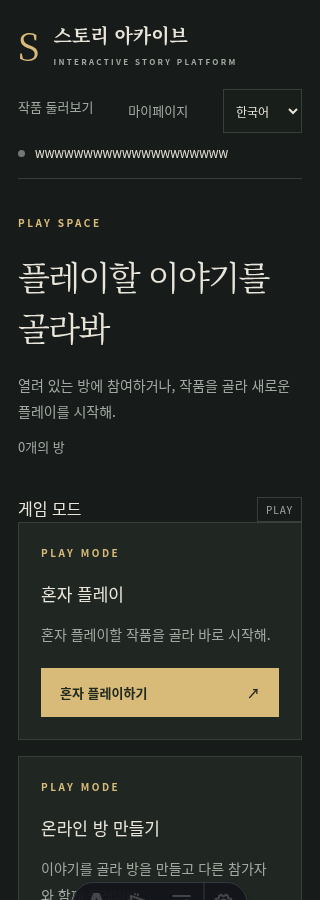
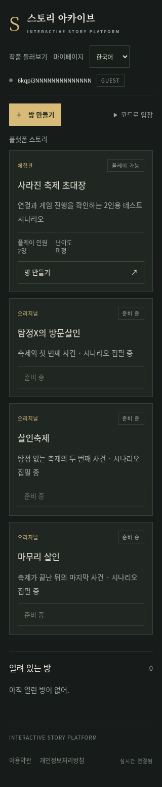
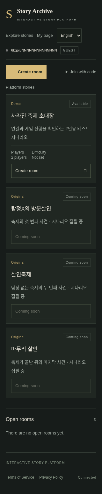
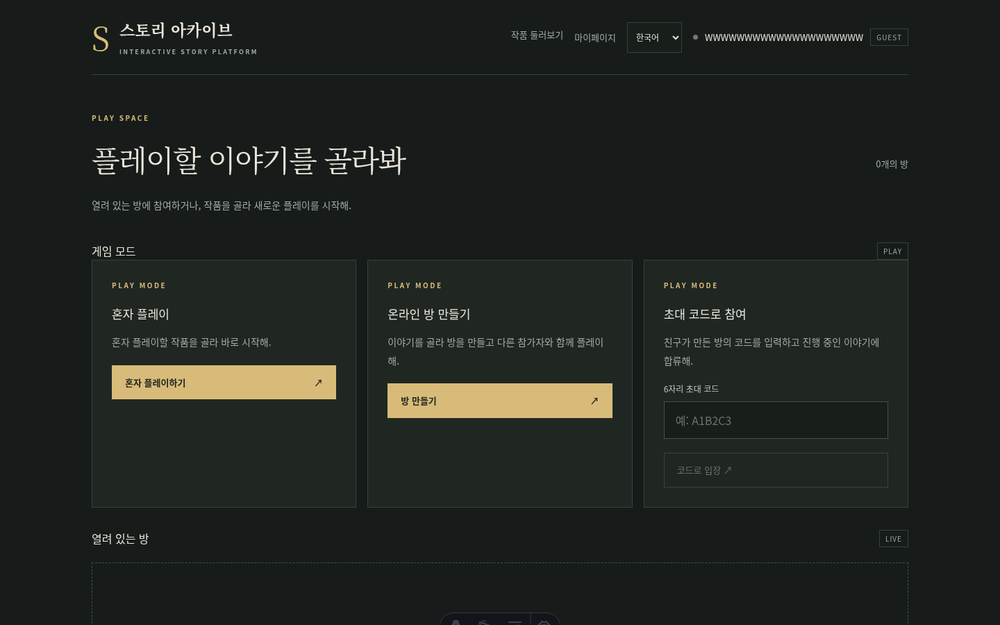
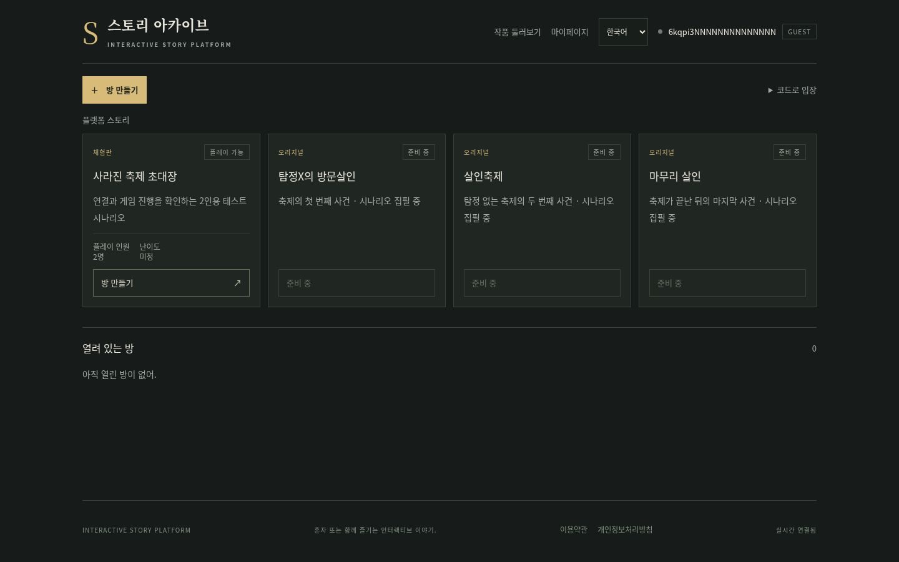
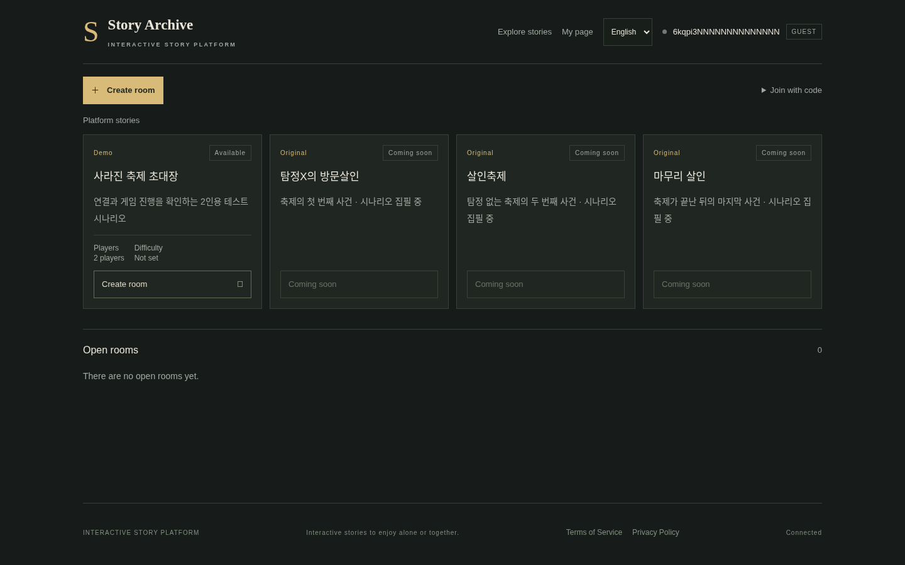

# 상단 내비게이션 검증 (#97)

실제 headless Chromium에서 변경 전 dev `15b51a1`와 최신 dev `5c8ebaf4230166c9d7b57c9cde8a51c7862bd163` 통합 후 UI를 확인했다.
측정 코드는 branch merge `77e750ec377607d39f3f1eb8432306284f242f34`였다.
게스트 로그인 후 매 실행마다 다른 20자 영문 닉네임을 사용했다.
한국어·영어 각각 320, 375, 640, 768, 1024, 1440px에서 전체 문서 가로 넘침이 없고,
작품 둘러보기 링크·언어 선택·상태 점·닉네임·계정 배지가 화면 안에 있으며 사용자 요소의 수직 중심 차이가 4px 이하임을 확인했다.
각 항목 사이 겹침이 없고 언어 변경과 창작마당 링크 이동도 확인했다. 전체 브라우저 측정은 [`browser-results.json`](browser-results.json)에 있다.

| 화면 | 변경 전 | 변경 후 |
| --- | --- | --- |
| 한국어 320px |  |  |
| 영어 320px |  |  |
| 한국어 1440px |  |  |
| 영어 1440px |  |  |

`.identity`의 `display:flex`와 `align-items:center`는 `apps/web/uno.config.ts`의
`identity` shortcut에서 제공한다. 닉네임 span은 flex item이므로 blockify되며,
`min-width:0`·`overflow:hidden`·`text-overflow:ellipsis`가 적용된다.
`base.css`의 공통 flex-wrap 규칙은 AppHeader의 scoped `.identity { flex-wrap: nowrap }`로 덮어쓴다.

`bash scripts/codex/verify.sh --browser`에서 check/build/66개 테스트 및 4,835 assertions가 통과했다.
자동 test:e2e 명령은 없으므로 wrapper는 예상대로 exit 1을 반환했으며,
이 문서의 실제 브라우저 근거로 보완했다. 통과하지 않은 명령을 통과로 표시하지 않는다.

실제 브라우저 시나리오는 [`browser.cjs`](browser.cjs)에서 재현할 수 있다. Playwright를 설치하고 Chromium 브라우저를 설치한 뒤, `DATABASE_PATH=:memory:`로 본인이 시작한 테스트 서버와 스크립트를 별도 터미널에서 실행한다. 브라우저를 열거나 요청하기 전에 정확한 loopback origin과 `DISPOSABLE_TEST_SERVER=1`을 확인한다. 기본값은 Playwright가 설치한 Chromium과 기본 샌드박스를 사용한다.

```sh
PORT=33723 DATABASE_PATH=:memory: APP_ORIGIN=http://127.0.0.1:33723 bun apps/server/src/index.ts
DISPOSABLE_TEST_SERVER=1 BASE_URL=http://127.0.0.1:33723 node docs/verification/issue97/browser.cjs
```

검사 후 서버를 중지하면 in-memory DB가 사라진다. 이 스크립트는 계정 데이터를 정리하지 않으며 QA/production 또는 기존 로컬 DB를 대상으로 실행할 수 없다.

관리형 컨테이너에서만 시스템 Chromium 경로와 샌드박스 설정이 필요할 수 있다. 이 변경을 검증한 컨테이너 명령은 아래와 같으며, 이 경로와 샌드박스 opt-in은 일반 개발 환경 기본값이 아니다.

```sh
DISPOSABLE_TEST_SERVER=1 BASE_URL=http://127.0.0.1:33723 PLAYWRIGHT_MODULE=playwright CHROMIUM_PATH=/usr/bin/chromium CHROMIUM_NO_SANDBOX=1 TESTED_BASE_COMMIT=5c8ebaf4230166c9d7b57c9cde8a51c7862bd163 TESTED_CODE_COMMIT=f2acd6b925e06b9b2baa58d4a68e13738faeb1e node docs/verification/issue97/browser.cjs
```
